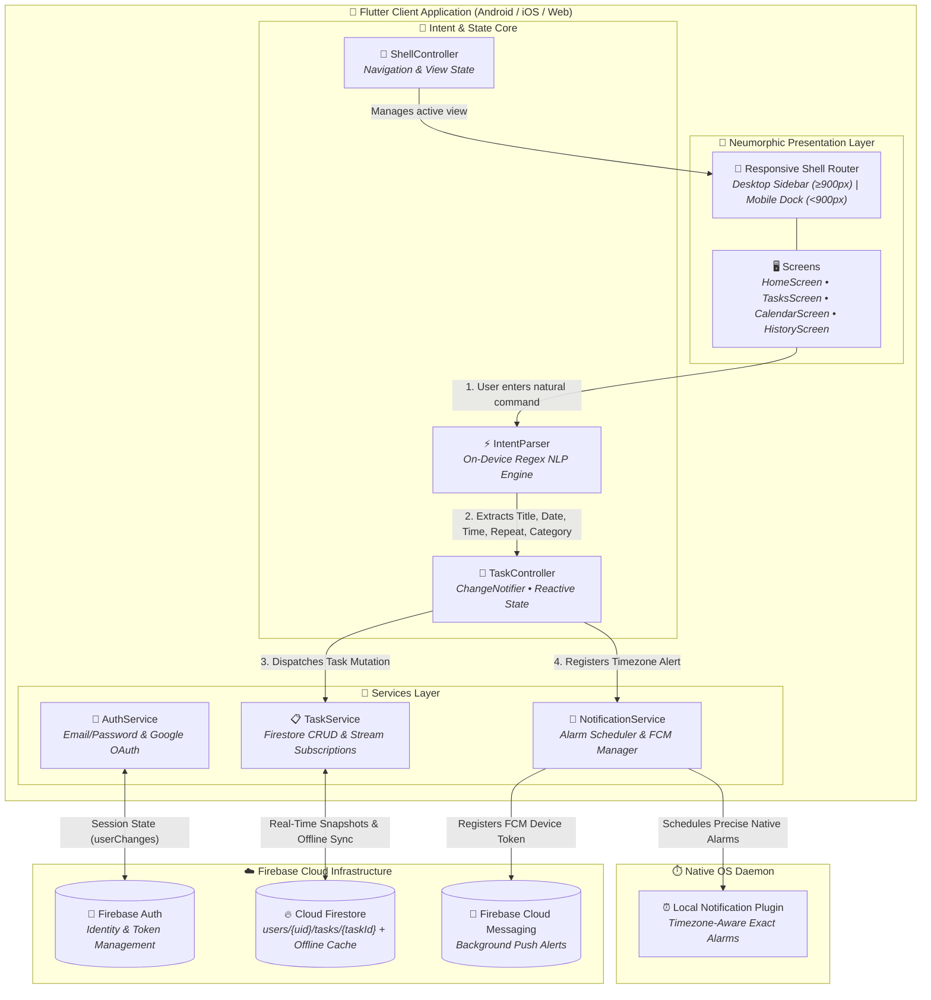
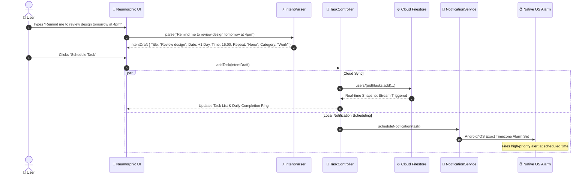

<div align="center">

# ⚡ IntentFlow
### *Turn Natural Language Into Scheduled Tasks & Automated Reminders*

A high-performance, cross-platform productivity application built with **Flutter** and **Firebase**, featuring an adaptive **Neumorphic design system**, an on-device **NLP intent parsing engine**, and **real-time cloud synchronization**.

---

[](https://flutter.dev)
[](https://dart.dev)
[](https://firebase.google.com)
[](#-responsive-design)
[](lib/theme.dart)
[](LICENSE)

<br/>

[Architecture](#-live-system-architecture) • [Data Flow](#-live-data-flow) • [Features](#-key-features) • [Intent Parser](#-natural-language-parser) • [Setup Guide](#-getting-started) • [Security](#-firestore-security-rules)

</div>

---

## 🏛️ Live System Architecture

The following diagram illustrates the live architecture of IntentFlow, from user input on client platforms down to reactive state management, background daemons, and cloud infrastructure:



---

## 🔄 Live Data Flow

Here is how an everyday natural language phrase is parsed, stored in the cloud, and turned into an OS-level notification in real time:



---

## ✨ Key Features

| Feature | Description | Architecture Component |
| :--- | :--- | :--- |
| **🧠 NLP Intent Engine** | Parses plain text into dates, times, frequencies, and auto-tagged categories. | [`IntentParser`](lib/utils/intent_parser.dart) |
| **🎨 Neumorphic Design** | Custom soft shadows, extruded tactile buttons, and inset inputs. | [`AppColors & NeuSurface`](lib/theme.dart) |
| **📱 Adaptive Layout** | Collapsible sidebar for desktop/web (≥900px), floating dock for mobile. | [`Responsive Widgets`](lib/widgets/responsive.dart) |
| **⚡ Real-Time Cloud Sync**| Firestore collection listeners with automatic local offline caching. | [`TaskService`](lib/services/task_service.dart) |
| **🔔 Smart Alarms** | Exact timezone notifications on device + FCM background push integration. | [`NotificationService`](lib/services/notification_service.dart) |
| **📅 Visual Calendar** | Monthly and weekly calendar view integrated with daily agenda lists. | [`CalendarScreen`](lib/screens/main/calendar_screen.dart) |
| **📊 Progress Analytics** | Circular completion ring and real-time task distribution metrics. | [`HomeScreen`](lib/screens/main/home_screen.dart) |
| **🔐 Secure Auth** | Email/Password, Google OAuth, password reset, and account deletion. | [`AuthService`](lib/services/auth_service.dart) |

---

## ⚡ Natural Language Parser

The parser runs **100% locally on-device**, ensuring instant response times without network latency or external API costs:

| Natural Language Input | Extracted Title | Scheduled Date | Scheduled Time | Interval | Category |
| :--- | :--- | :---: | :---: | :---: | :---: |
| `"Remind me to call John tomorrow at 3pm"` | **Call John** | Tomorrow | `15:00` | None | Personal |
| `"Gym workout every day at 6:30am"` | **Gym workout** | Today | `06:30` | Daily | Health |
| `"Schedule team standup next week at 10am"`| **Team standup** | +7 Days | `10:00` | Weekly | Work |
| `"Pay electricity bill at 5pm"` | **Pay electricity bill** | Today | `17:00` | None | Work |

---

## 📱 Responsive Design

IntentFlow automatically detects window size and adapts its structural shell seamlessly:

<div align="center">

```text
┌────────────────────────────────────────────────────────────────────────┐
│                        DESKTOP & WEB (≥ 900px)                         │
├───────────────┬────────────────────────────────────────────────────────┤
│  IntentFlow   │ Top Bar: View Title • Profile • Notification Bell      │
│  ───────────  ├────────────────────────────┬───────────────────────────┤
│  [●] Home     │ ⚡ Natural Language Input  │ 📊 Daily Progress Ring    │
│  [ ] Tasks    │ ────────────────────────── │ ───────────────────────── │
│  [ ] Calendar │ 📋 Filterable Task Cards   │ 📅 Mini Calendar Preview  │
│  [ ] History  │   • Check-off toggles      │ ⏰ Upcoming Agenda Items  │
│  [ ] Profile  │   • Color-coded category   │                           │
└───────────────┴────────────────────────────┴───────────────────────────┘

┌──────────────────────────────────────┐
│           MOBILE (< 900px)           │
├──────────────────────────────────────┤
│ ⚡ Intent Command Bar                 │
│ 📊 Progress Summary Ring             │
│ 📋 Scrollable Task Cards             │
├──────────────────────────────────────┤
│ [ Home | Tasks | Cal | Hist | Prof ] │  ◄── Floating Neumorphic Dock
└──────────────────────────────────────┘
```

</div>

---

## 📂 Project Structure

```text
lib/
├── firebase_options.dart          # Multiplatform Firebase bootstrap configuration
├── main.dart                      # Application root & service initialization
├── theme.dart                     # Neumorphic color palette, shadows & typography
│
├── models/
│   └── task_model.dart            # Task entity, serialization, and category styles
│
├── screens/
│   ├── auth/                      # Login, Registration, Auth Gate & Social Auth
│   └── main/                      # Home, Tasks, Calendar, History, Intent & Profile
│
├── services/
│   ├── auth_service.dart          # Firebase Auth & Google Sign-In handler
│   ├── notification_service.dart  # Timezone scheduling & FCM background worker
│   ├── task_controller.dart       # Reactive state controller for tasks & progress
│   └── task_service.dart          # Firestore streams, queries, and transactions
│
├── utils/
│   ├── intent_parser.dart         # Rule-based NLP extraction engine
│   └── validators.dart            # Strong password, email, and input sanitizers
│
└── widgets/
    ├── common.dart                # Neumorphic buttons, cards, text fields, chips
    ├── notifications.dart         # In-app notification center modal & badge
    └── responsive.dart            # Adaptive layout engine (Desktop vs. Mobile)
```

---

## 🚀 Getting Started

<details open>
<summary><b>1. Prerequisites</b></summary>

- [Flutter SDK](https://docs.flutter.dev/get-started/install) (`>= 3.3.0`)
- [Dart SDK](https://dart.dev/get-dart) (`>= 3.3.0 < 4.0.0`)
- [Firebase CLI](https://firebase.google.com/docs/cli)
- Android Studio / Xcode (for device emulators and platform toolchains)

</details>

<details open>
<summary><b>2. Installation & Setup</b></summary>

```bash
# 1. Clone repository
git clone https://github.com/your-username/intentflow.git
cd intentflow

# 2. Install dependencies
flutter pub get

# 3. Configure Firebase project
dart pub global activate flutterfire_cli
flutterfire configure

# 4. Deploy Firestore security rules
firebase deploy --only firestore:rules
```

</details>

<details>
<summary><b>3. Platform-Specific Setup (Android & iOS)</b></summary>

### Android
- **Google Sign-In**: Generate your signing certificate fingerprints:
  ```bash
  cd android && ./gradlew signingReport
  ```
  Add both `SHA-1` and `SHA-256` into your Firebase Console Android app settings, then re-download `google-services.json` into `android/app/`.

### iOS
- In `ios/Runner/Info.plist`, verify that the `REVERSED_CLIENT_ID` from your `GoogleService-Info.plist` is registered as a URL scheme.

</details>

<details open>
<summary><b>4. Running the App</b></summary>

```bash
# Run on an attached mobile device or emulator
flutter run

# Run on Web (Chrome)
flutter run -d chrome

# Run in release mode
flutter run --release
```

</details>

---

## 🛡️ Firestore Security Rules

Cloud Firestore enforces user-isolated access controls defined in [`firestore.rules`](firestore.rules):

<details>
<summary><b>View firestore.rules</b></summary>

```javascript
rules_version = '2';
service cloud.firestore {
  match /databases/{database}/documents {

    function signedIn() { return request.auth != null; }
    function isOwner(uid) { return signedIn() && request.auth.uid == uid; }

    function validTask(d) {
      return d.keys().hasOnly(['title','category','color','date','time','repeat','done','createdAt','updatedAt'])
        && d.title is string && d.title.size() > 0 && d.title.size() <= 200
        && d.category in ['Work','Personal','Health']
        && d.date is string && d.date.matches('^[0-9]{4}-[0-9]{2}-[0-9]{2}$')
        && d.time is string && d.time.matches('^[0-9]{2}:[0-9]{2}$')
        && d.repeat in ['None','Daily','Weekly']
        && d.done is bool;
    }

    match /users/{uid} {
      allow read, create, update, delete: if isOwner(uid);

      match /tasks/{taskId} {
        allow read, delete: if isOwner(uid);
        allow create, update: if isOwner(uid) && validTask(request.resource.data);
      }
    }

    match /{document=**} { allow read, write: if false; }
  }
}
```

</details>

---

## 📄 License

Distributed under the **MIT License**. See [`LICENSE`](LICENSE) for more information.
# Intent-Flow

